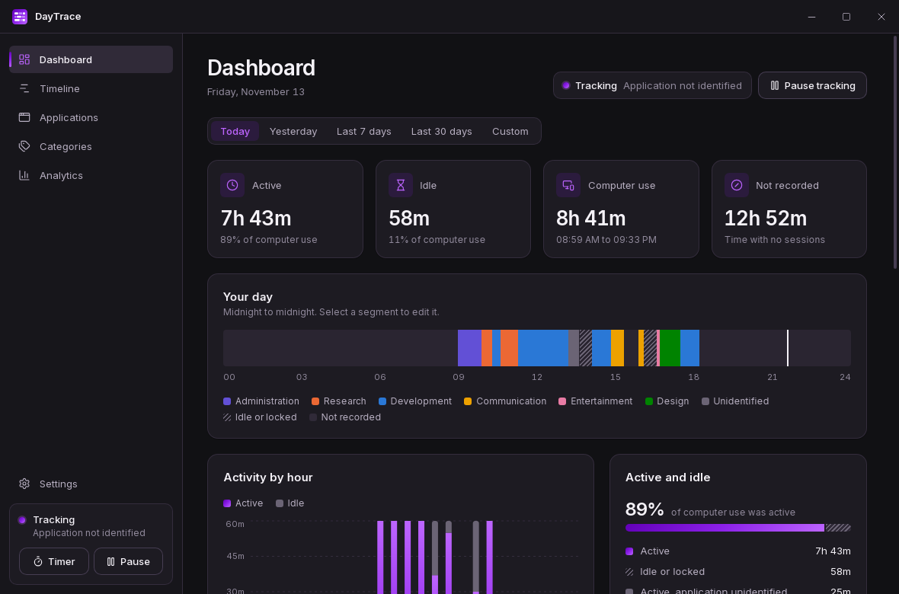
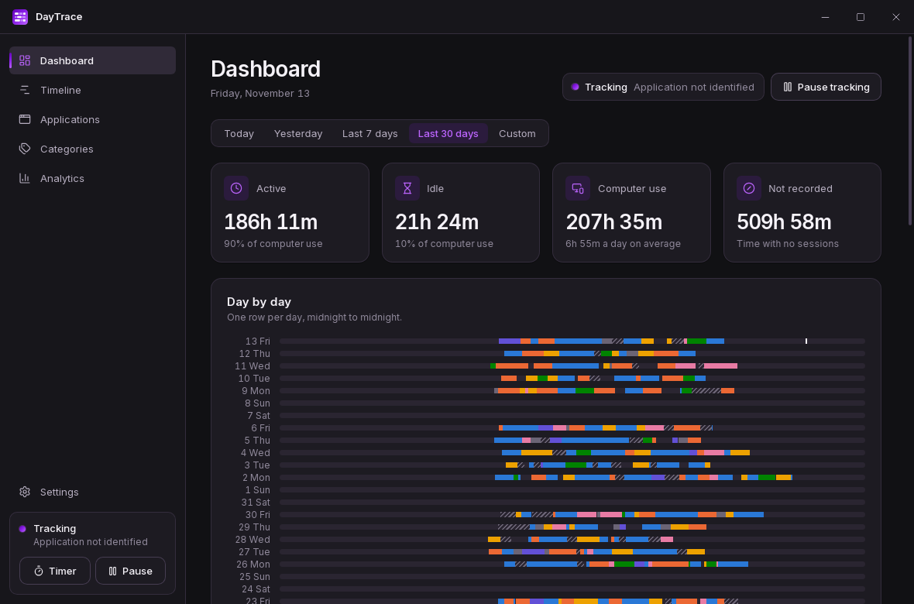
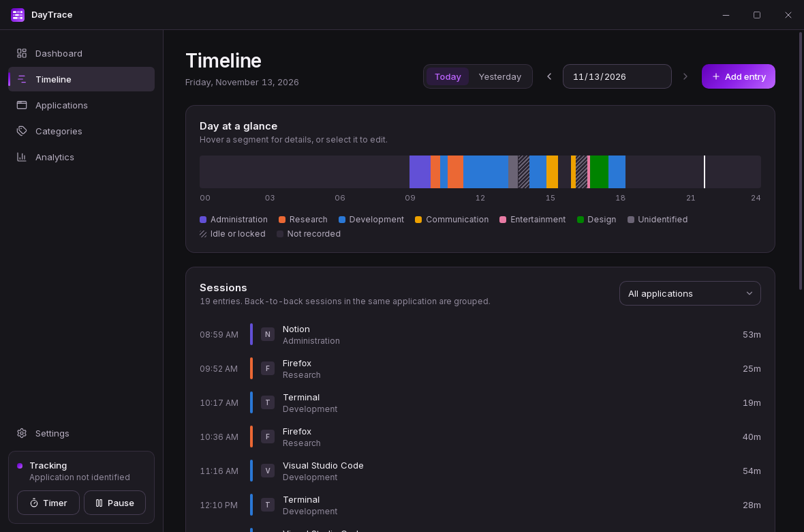
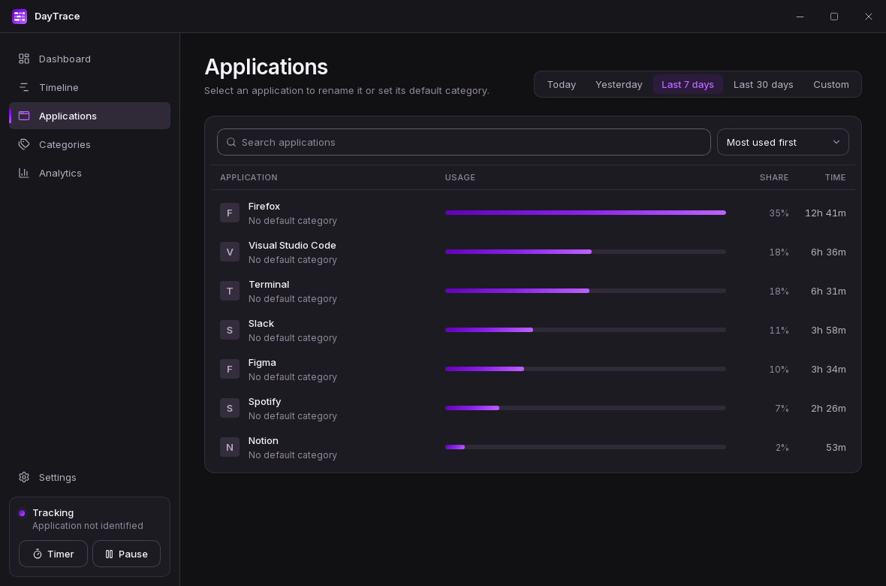
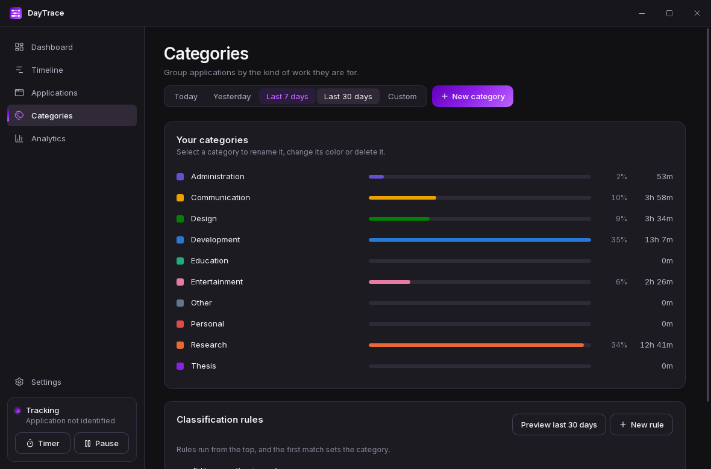
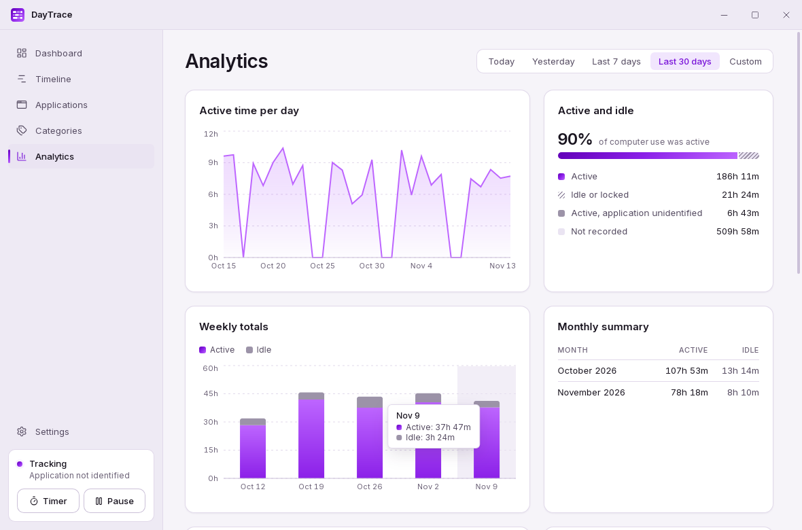
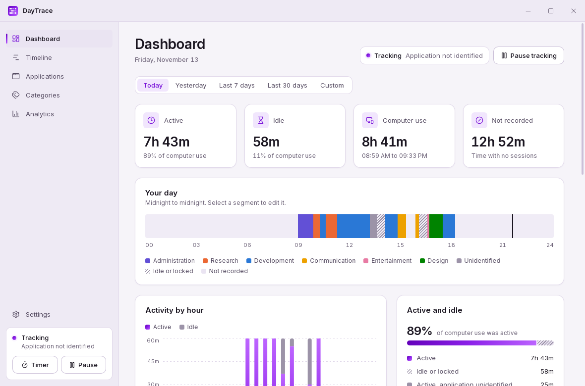
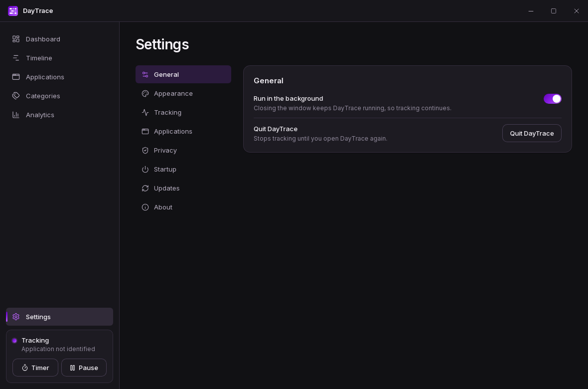

# DayTrace

DayTrace records how you use your computer, without timers. It answers three questions:

1. Where did my time go?
2. What did I spend my time working on?
3. How is my computer usage changing over time?

Everything stays on your computer. There is no account, no cloud service and no telemetry.

















Screenshots show generated sample data.

## Features

- Automatic tracking of the focused application, with idle time kept separate from use
- A day ribbon that shows each day on a 24-hour scale, stacked to show a week or month
- A timeline where you can correct, relabel, add and delete sessions
- Custom categories and colors
- Classification rules with predictable precedence, and a preview before they change history
- Analytics for daily, weekly and monthly trends, plus rankings and an hour-by-weekday view
- Manual timers, which work even where automatic tracking cannot
- Tracking pause, exclusions, retention limits, export, backup and full deletion
- Starting with your computer, running in the background, and a system tray menu
- Signed updates that respect how DayTrace was installed
- Light, dark and system themes

## Supported systems

| System | Status |
| --- | --- |
| GNOME on Wayland | Tested on GNOME 50. Needs the bundled Shell extension, installed from Settings |
| wlroots compositors (Sway and others) | Tested on Sway. No program paths |
| X11 | Tested against a real X server |
| KDE Plasma on Wayland | Implemented, not yet tested on KDE |
| Windows 10 and 11 | Core logic tested on Windows in CI. The application has not yet been run on a Windows desktop |

[docs/VERIFICATION.md](docs/VERIFICATION.md) lists exactly what has and has not been run. DayTrace
reports what works on your computer during setup and in Settings, and it never guesses.

## Install

See [INSTALLATION.md](INSTALLATION.md).

## Build from source

You need Rust, Node.js 22 and the [Tauri system dependencies](https://tauri.app/start/prerequisites/).

```bash
npm install
npm run tauri build
```

See [DEVELOPMENT.md](DEVELOPMENT.md) for details.

## Privacy

DayTrace records the focused application's name and program path, session times, and idle or
locked periods. It never records keystrokes, passwords, clipboard contents, screenshots, audio,
video, private messages or browser history. Window titles stay off unless you turn them on, and
tracking starts only after you agree to it. [PRIVACY.md](PRIVACY.md) has the full list.

## Known limitations

- **GNOME on Wayland needs an extension.** GNOME does not let applications see the focused window.
  After you install the integration from Settings, you must log out and back in once.
- **Browser domains are not tracked.** Sites cannot be told apart unless you opt in to window titles
  and write rules against them. A browser integration is not included.
- **Snap has reduced tracking.** Strict confinement blocks program paths and the GNOME integration.
- **Time is shown in your current timezone.** After travelling, past sessions move with it.
- **Applications running as administrator on Windows** may appear as unidentified.
- **Background memory is about 96 MB**, because the webview libraries stay loaded. See
  [docs/BENCHMARKS.md](docs/BENCHMARKS.md).

## Contributing

See [CONTRIBUTING.md](CONTRIBUTING.md). Security reports go through [SECURITY.md](SECURITY.md).

## License

[MIT](LICENSE)
